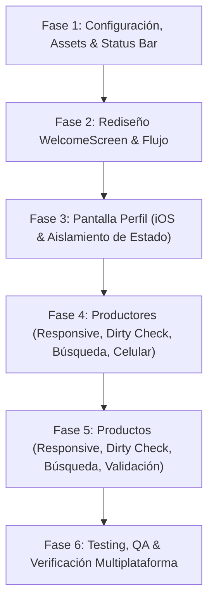

# Planificación Integral de Tareas - Sabor Andino
**Stack Tecnológico:** React Native (0.88.0) | Expo SDK (58.0.19) | Expo Router | Firebase (Auth & Firestore) | Supabase (Storage)

Este documento contiene la planificación técnica exhaustiva, análisis arquitectónico y desglose de tareas paso a paso para la refactorización, optimización y cumplimiento de requerimientos en la aplicación móvil **Sabor Andino**.

---

## 📋 Resumen del Diagnóstico del Proyecto

| Área / Módulo | Estado Actual | Puntos Críticos Detectados |
| :--- | :--- | :--- |
| **Estructura y Assets** | Imágenes en la raíz (`logo.png`, `img1.png`, `img2.png`, `img3.png`). | Rutas no estandarizadas, assets fuera del árbol de compilación de Expo. |
| **Status Bar (iOS)** | La barra superior adopta el color claro `#F4F0EA` por SafeAreaView. | Falta contraste y consistencia de marca con el terracota institucional (`#7A2214`). |
| **WelcomeScreen** | Usa bypass de `AsyncStorage` (`WELCOME_SEEN_KEY`). Usa ícono genérico `Ionicons`. | No muestra el logo real ni la sección de misión con las imágenes locales requeridas. |
| **ProfileScreen** | Inputs mutan en tiempo real el nombre de la cabecera e iniciales del avatar. | Botones con posibles problemas de renderizado en iOS; estado no aislado hasta confirmar guardado. |
| **ProductorScreen** | Tarjetas con riesgo de desbordamiento horizontal; búsqueda busca en 4 campos. | Celular no es validado como obligatorio; no hay dirty-check en edición; errores en modal solo usan `Alert`. |
| **ProductScreen** | Búsqueda por 4 campos simultáneos; edición ejecuta mutación sin dirty-check. | Errores en modales no se renderizan visualmente dentro del flujo del formulario. |

---

## 🎯 Plan de Fases de Implementación

---

## 🛠️ Desglose Detallado de Tareas

### Fase 1: Configuración General, Assets y Barra de Estado iOS
* **Objetivo:** Limpiar la raíz del proyecto, reubicar los assets en sus directorios canónicos y asegurar que la barra de estado en iOS mantenga el color `#7A2214` con contraste adecuado.

* **Tareas Técnicas:**
  1. **Reorganización de Assets:**
     - Mover `logo.png`, `img1.png`, `img2.png` y `img3.png` desde la raíz a `assets/images/` (o crear subdirectorio `assets/images/brand/`).
     - Registrar o verificar las exportaciones correspondientes para garantizar resolución correcta por Metro Bundler.
  2. **Configuración de Status Bar en iOS:**
     - Ajustar en `app.json` la propiedad `userInterfaceStyle` y parámetros nativos si corresponde.
     - Configurar `StatusBar` de `expo-status-bar` con `style="light"`.
     - En pantallas con cabecera terracota (`Welcome`, `Perfil`, `Productores`, `Productos`), asegurar que la vista que envuelve el notch / isla dinámica en iOS (`SafeAreaView` con `edges={['top']}` o contenedor superior) tenga como fondo el color `#7A2214`.
     - Garantizar que la barra de hora, batería y señal no colisione ni se vuelva ilegible en dispositivos iOS con notch o Dynamic Island.

---

### Fase 2: Pantalla de Bienvenida (`WelcomeScreen` - `src/app/welcome.tsx`)
* **Objetivo:** Establecer la pantalla de bienvenida como punto de entrada prioritario antes del login, rediseñar su interfaz con el color institucional `#7A2214`, incorporar el logo real y renderizar la misión con la galería de imágenes locales.

* **Tareas Técnicas:**
  1. **Ajuste del Flujo de Navegación (`src/app/_layout.tsx`):**
     - Revisar el gatekeeper de navegación para que la pantalla `/welcome` se muestre de manera predeterminada al iniciar la aplicación si no existe una sesión activa de usuario.
     - Ajustar o simplificar la lógica de `WELCOME_SEEN_KEY` según el comportamiento requerido (siempre visible como splash/landing de bienvenida previa al login).
  2. **Rediseño Visual con Fondo Completo `#7A2214`:**
     - Asignar `backgroundColor: '#7A2214'` a todo el contenedor de la pantalla y al área de Safe Area.
     - Reemplazar el ícono genérico (`Ionicons name="shapes"`) por el logo oficial (`logo.png`) utilizando `<Image contentFit="contain" />`.
     - Renderizar la tipografía institucional: Título *"Sabor Andino"* y subtítulo *"Especias del Norte"*.
     - Diseñar el botón principal con el texto *"Bienvenido"*, con diseño accesible y llamada a la acción para redirigir a `/login`.
  3. **Sección de Misión y Galería de Imágenes:**
     - Construir una tarjeta o sección contenedora inferior con el texto oficial de la misión de Sabor Andino.
     - Integrar estéticamente las imágenes de producto y campo (`img1.png`, `img2.png`, `img3.png`), ya sea en formato grilla armónica con bordes redondeados (`borderRadius: 12`) o carrusel horizontal con scroll suave.
     - Añadir microtextos o badges descriptivos de la trayectoria ("Desde 2009 en los Valles Calchaquíes").

---

### Fase 3: Pantalla de Perfil (`ProfileScreen` - `src/app/(tabs)/perfil.tsx`)
* **Objetivo:** Resolver problemas de renderizado de texto en botones en iOS y aislar el estado de los inputs de edición del estado visual de la cabecera hasta que se guarde explícitamente.

* **Tareas Técnicas:**
  1. **Corrección de Renderizado de Botones en iOS:**
     - Auditar los componentes `<TouchableOpacity>` y `<Text>` de los botones principales (`submitButton`, `logoutButton`, botones de modal).
     - Aplicar propiedades seguras para iOS:
       - `alignItems: 'center'` y `justifyContent: 'center'`.
       - Altura mínima táctil (`minHeight: 48`) según las directrices HIG de Apple.
       - Declarar explícitamente `color`, `fontSize`, `fontWeight` y `textAlign: 'center'`.
       - Evitar truncamientos de texto ocasionados por padding desbalanceado o `flexDirection`.
  2. **Aislamiento del Estado de Edición (Nombre y Apellido):**
     - Desacoplar el estado de los campos de texto (`ediciones.nombre`, `ediciones.apellido`) del estado que alimenta la cabecera (`userNameText`) y el avatar dinámico (`iniciales`).
     - Mantener los valores reflejados en la cabecera vinculados estrictamente al estado persistido (`userProfile` de Firestore / Firebase Auth).
     - Solo al hacer clic en "Guardar cambios" y validarse exitosamente la operación en Firestore, sincronizar y refrescar la cabecera con los nuevos datos.

---

### Fase 4: Pantalla de Productores (`ProductorScreen` - `src/app/(tabs)/productores.tsx`)
* **Objetivo:** Optimizar la adaptabilidad responsive de tarjetas, mostrar errores visuales en modales, hacer obligatorio el campo celular, incorporar dirty-check antes de guardar y acotar el buscador únicamente a nombre/apellido.

* **Tareas Técnicas:**
  1. **Responsive Cards:**
     - Refactorizar `cardHeader` y `metaRow` utilizando `flexWrap: 'wrap'`, `flexShrink: 1` y espacios controlados con `gap`.
     - Evitar que la botonera de acciones (`actionsRow`: Ver, Editar, Eliminar) se superponga o empuje fuera de pantalla el nombre o los datos en pantallas de menos de 375px de ancho.
  2. **Validación Visual de Errores en Modal:**
     - Incorporar un estado `formError: string | null` dentro del modal (crear y editar).
     - Renderizar un banner de error visual con fondo suave (`#FFEBEE`), borde rojo y texto claro (`#D32F2F`) dentro del cuerpo del modal cuando falle la validación o la escritura en Firestore.
  3. **Celular como Campo Obligatorio:**
     - Actualizar la lógica de validación para que el campo `celular` sea mandatorio (`!celular.trim() -> "El número de celular es obligatorio"`).
     - Validar que cumpla con el formato numérico/telefónico antes de permitir el envío.
  4. **Optimización de Guardado (Dirty Check):**
     - Implementar una función `isDirty(original, actual)` que compare campos modificables: `nombre`, `localidad`, `productosIds`, `direccion`, `celular`, `redesSociales` y `fotoUrl`.
     - Si el formulario no ha sido modificado, cerrar el modal o mostrar un aviso informativo sin disparar peticiones de escritura a Firebase Firestore.
  5. **Búsqueda Específica por Nombre / Apellido:**
     - Limpiar el predicado del filtro de búsqueda en `productoresFiltrados` para que evalúe **únicamente** sobre `p.nombre` (descartando localidad, celular y nombres de productos).

---

### Fase 5: Pantalla de Productos (`ProductScreen` - `src/app/(tabs)/productos.tsx`)
* **Objetivo:** Homologar mejoras de tarjetas adaptativas, errores visuales en modales, dirty check en la edición y delimitación de la búsqueda solo por nombre.

* **Tareas Técnicas:**
  1. **Responsive Cards:**
     - Adaptar `cardHeader`, `metaRow` y badges de stock/presentación para visualización óptima en pantallas pequeñas.
     - Garantizar que los nombres largos de productos y códigos de lote se ajusten correctamente sin romper la cuadrícula.
  2. **Validación Visual de Errores en Modal:**
     - Integrar un contenedor visual de errores inline en los modales de creación y edición de productos, sustituyendo la dependencia exclusiva de diálogos nativos `Alert`.
  3. **Optimización de Guardado (Dirty Check):**
     - Implementar función de detección de cambios comparando: `nombre`, `color`, `lote`, `stock`, `presentacion`, `productoresIds` y `fotoUrl`.
     - Impedir peticiones innecesarias a la base de datos si ningún campo fue modificado por el usuario.
  4. **Búsqueda Específica por Nombre de Producto:**
     - Modificar el filtro de búsqueda para evaluar **únicamente** si `p.nombre.toLowerCase().includes(busqueda.toLowerCase())` (descartando lote, presentación y productores asociados).

---

### Fase 6: Criterios de Aceptación, QA y Validación

* **Criterios de Aceptación:**
  - [ ] Compilación TypeScript sin errores: `npx tsc --noEmit` retorna código de salida `0`.
  - [ ] Código libre de errores de linting: `npx eslint .` pasa con `0` advertencias críticas.
  - [ ] Assets organizados en `assets/images/` sin archivos sueltos en la raíz.
  - [ ] Status Bar en iOS renderiza `#7A2214` y texto blanco sin desfasajes en el notch.
  - [ ] `WelcomeScreen` muestra fondo terracota completo, logo oficial, botón "Bienvenido" y sección de misión con las 3 imágenes.
  - [ ] En `PerfilScreen`, los botones responden y renderizan su texto legiblemente en iOS; el nombre en la cabecera no muta mientras el usuario escribe en el input hasta que hace clic en "Guardar cambios".
  - [ ] En `ProductorScreen`, el celular es estrictamente obligatorio; la búsqueda solo filtra por nombre/apellido; las tarjetas no se desbordan; el modal muestra errores visuales y no muta Firestore si no hay cambios.
  - [ ] En `ProductScreen`, la búsqueda solo filtra por nombre de producto; las tarjetas son responsive; el modal muestra errores inline y cuenta con dirty check.